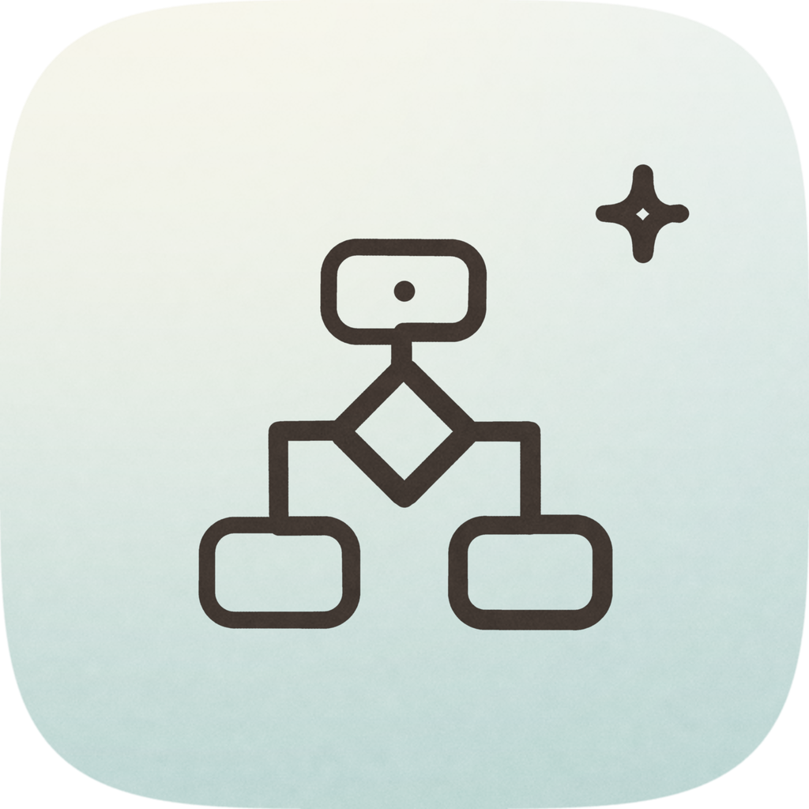

# Workflow Diagram Builder



Turn code or a process description into a clear Mermaid workflow diagram. See who does each step. Distinguish manual work from automated work. Revise the diagram through conversation.

## Start a diagram

Ask the plugin to diagram a workflow. Paste its code or describe its steps. The plugin asks up to three opening questions. It skips facts you have already supplied.

The questions establish the source, the reader, and the level of detail. You can answer them together or ask the plugin to choose reasonable defaults.

Each answer informs the next question. The plugin creates the diagram when it has the required facts. A changed answer updates the current flow.

The plugin returns Mermaid text. A compatible viewer displays that text as a diagram. Manual nodes are orange. Automated nodes are dark blue. Each node also has a visible type label.

## Revise the diagram

Give feedback in the same conversation. For example:

- "Name who checks the record ID in every step."
- "I cannot tell those colors apart. Increase the contrast."
- "Split the diagram into smaller stages."
- "Include the failed request and manual retry."

The plugin uses your previous answers. It returns the complete updated diagram. It asks another question only when a required fact remains unknown.

Interaction happens through conversation. The diagram itself is a static Mermaid flowchart.

## Use in Claude Code

Load the plugin for one session from this repository's folder:

```bash
claude --plugin-dir .
```

Start the bundled skill:

```text
/workflow-diagram-builder:workflow-diagram Diagram the workflow in this conversation. Ask me about any missing facts.
```

Validate the package:

```bash
claude plugin validate . --strict
```

The [Claude plugin reference](https://code.claude.com/docs/en/plugins-reference) documents the package format.

## Use the portable skill in Codex

The skill folder is `skills/workflow-diagram`. Place that folder in your Codex skills directory. Start a new session so Codex can discover it. Invoke `$workflow-diagram` with the code or workflow description.

The plugin package includes the same skill. The separate skill archive contains only that folder.

## Create a saved diagram

The assistant can use the bundled helper when a local Python runner is available. The helper reads a structured workflow. It checks required labels and connections. It writes Mermaid source.

Run the fictional example from the plugin folder:

```bash
python3 skills/workflow-diagram/scripts/build_mermaid.py \
  skills/workflow-diagram/references/example-workflow.json \
  --output example.mmd
```

The helper requires Python 3. It uses the Python standard library. The assistant reads the original source and prepares the structured workflow. The helper checks structure. The assistant still checks meaning against the source.

The [Mermaid flowchart reference](https://mermaid.js.org/syntax/flowchart.html) documents the diagram syntax.

## Read the guide

Read [how this plugin works](Workflow-Diagram-Builder-HowItWorks-2026-10-03.md) for its trigger, inputs, steps, and outputs. The skill can also write a guide for a workflow you select.

## Source and access

The plugin uses the source and answers supplied in the current conversation. Reading a connected system requires the host's available tools and the user's authorized scope. The plugin package contains no account credentials or service connections.

The default writing rules adapt the author's supplied auto and voice-align instructions. The [diagram rules](skills/workflow-diagram/references/diagram-rules.md) preserve the corrections from the original diagram conversation. The bundled examples are fictional.

## Verification

Version 1.1.0 passes Claude Code's strict manifest check and the skill format check. The helper passes 13 checks. Four sample diagrams render with Mermaid 11.12.1. The rendered samples preserve special characters and show the expected node colors.

The conversational interview is defined in the skill instructions. A live interactive host session has not been tested. See the [verification record](VERIFICATION.md) for the checks and review prompts.
