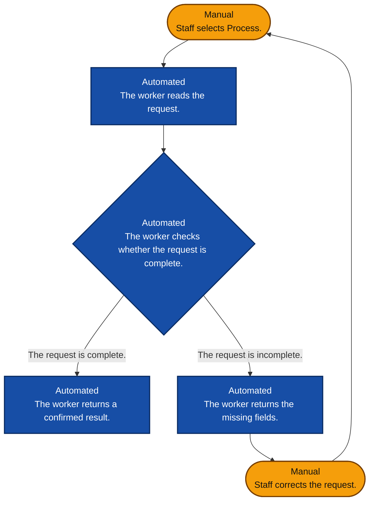

# Diagram rules

These rules capture the corrections that shaped this workflow.

| User request | Apply this rule. |
| --- | --- |
| Explain how the workflow works. | Trace the actual source before drawing the flow. |
| Create a clearer diagram. | Show the trigger, actions, decisions, and outcomes in reading order. |
| Avoid analogies. | Describe the actual people, systems, records, and actions. |
| Name who checks the record ID. | Name the actor in every check. Separate a format check from a record lookup. |
| Give each step a subject, verb, and object. | Write a complete action sentence in every node. |
| Distinguish manual and automated steps. | Classify every node from the source or a confirmed answer. |
| Make the colors easier to distinguish. | Use orange for manual work and dark blue for automated work. Keep text readable. |
| Use Mermaid. | Return a fenced Mermaid flowchart that the user can copy and edit. |
| Keep the task focused on the diagram. | Apply feedback to the diagram before proposing other work. |
| Make the plugin respond to the user. | Ask a few useful questions. Keep previous answers. Revise the complete diagram after feedback. |

## Default Mermaid styles

This example describes a fictional workflow. Its retry is confirmed only within that example.

## Checks that need separate steps

- A worker checks whether an identifier follows a required format.
- A database reads the record with that identifier.
- A worker checks whether the database returned a record.

These actions answer different questions. Show only the actions the source actually performs.

## Unclear outcomes

A service can accept a request before the caller loses the response. If the source distinguishes this case, show "The outcome is unclear" as a separate route. Do not label that route as a confirmed rejection.

## Unknown actors and step types

Use "Unknown actor" when the source does not name an actor. Write an action sentence only when the action itself is known. Use the Unknown class when the source does not establish whether a person or an automation performs that step. Name the missing fact in a short note.
